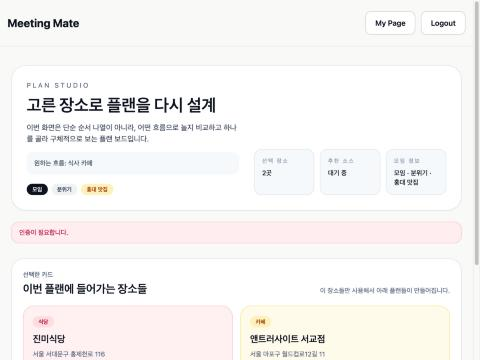
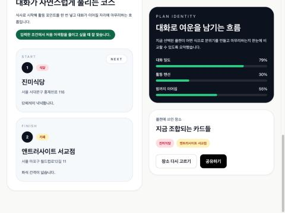

# access token 만료 시 사용자 경험 개선: refresh token 도입

- 날짜: 2026-11-10
- 환경: 로컬 docker-compose 백엔드 + Vite 개발 서버(운영 Nginx와 같은 경로 프록시), 브라우저로 직접 재현
- 관련 커밋: `feat(auth): refresh tokens with rotation and reuse detection`

## 1. 문제

access token(JWT, 1시간)만 있고 refresh token은 없었다. 토큰이 만료되면 어떤 일이 생기는지 확인한 적이 없었다.

## 2. 재현 (access token 수명을 60초로 줄여서)

1. 로컬 계정으로 로그인한 뒤 "홍대 맛집"을 조건으로 추천을 받는다. 정상으로 표시된다.
2. 결과 화면에서 장소를 고르는 동안 토큰이 만료된다.
3. "선택한 장소로 다음 단계"를 누른다.

- 코스 추천 API가 **401**을 받는다. 화면에는 빨간 문구 **"인증이 필요합니다."** 만 나온다.
- 헤더는 여전히 `My Page / Logout`이다. 만료된 토큰이 localStorage에 남아 있어서 **로그인된 것처럼 보인다.**
- 사용자는 스스로 로그아웃 → 다시 로그인 → **조건 입력부터 처음부터** 다시 해야 한다.
- 참고: 2-1 수정 전에는 401이 아니라 `/login`으로의 302 리다이렉트였다. axios가 그 HTML을 받아 더 알 수 없는 오류가 났을 것이다.

추가로 발견한 보안 문제가 있다. 카카오/구글 로그인 후 백엔드가 **`/oauth/callback?token=<JWT>`처럼 URL에 access token을 붙여** 리다이렉트하고 있었다. 이 URL은 브라우저 기록, Nginx 접근 로그, 다른 사이트로 가는 Referer 헤더에 남는다.

## 3. 설계

| 항목 | 결정 | 이유 |
|---|---|---|
| access token | **15분**(기존 1시간), `Authorization` 헤더 | 2-3에서 인증을 stateless로 바꿨다. 탈퇴한 계정의 토큰이 만료 전까지 유효하므로 그 구간을 줄인다 |
| refresh token 형태 | 임의의 256비트 값 (JWT 아님) | 서버가 DB로 상태를 관리하므로 서명이 필요 없다. 폐기는 행 하나를 갱신하면 된다 |
| 저장 | DB에는 **SHA-256 해시만** 저장 | DB가 유출돼도 원문으로 로그인할 수 없다 |
| 전달 | **HttpOnly + Secure + SameSite=Strict** 쿠키, `Path=/api/auth`, 14일 | JS에서 읽을 수 없어 XSS에 안전하다. 다른 사이트 요청에는 전송되지 않아, 쿠키로 인증하는 `/refresh`가 CSRF로부터 안전하다. 일반 API 호출에는 실리지 않는다 |
| 회전(rotation) | `/refresh`를 쓸 때마다 새 토큰을 발급하고 이전 토큰을 폐기 | 탈취된 토큰을 쓸 수 있는 시간이 짧아진다 |
| 재사용 탐지 | 이미 회전된 토큰이 다시 오면 **같은 로그인의 토큰 계열(family) 전체를 폐기** | 같은 토큰을 두 곳이 가지고 있다는 뜻이다(한쪽은 탈취). 공격자와 사용자 둘 다 다시 로그인해야 한다 |
| 동시 갱신 유예 10초 | 회전 후 10초 안에 같은 토큰이 오면 탐지하지 않고 새 토큰을 발급 | 탭 두 개가 동시에 갱신해도 정상 사용자가 로그아웃되지 않는다 |
| 원자적 사용 | `UPDATE ... WHERE id=? AND revoked_at IS NULL`의 결과 행 수로 판정 | 같은 순간에 같은 토큰으로 두 요청이 와도 회전은 한 번만 일어난다 |
| OAuth 콜백 | URL에서 토큰을 없애고 쿠키만 심음. 프론트가 `/refresh`로 access token을 받음 | 토큰이 URL을 통해 새지 않는다 |
| 로그아웃 / 탈퇴 | 로그아웃은 해당 계열 폐기, 탈퇴는 그 사용자의 모든 기기 토큰 폐기 | 탈퇴 후에는 남은 access token(최대 15분)이 지나면 재발급이 불가능하다 |
| 만료 토큰 정리 | 매일 1회, **1,000건씩 나눠** 삭제 | 1단계에서 대량 DELETE 한 번에 512MB MySQL이 OOM으로 죽었다 |
| 저장소 | 기존 MySQL 테이블 (`refresh_token`) | Redis를 추가하면 소형 EC2에 프로세스와 비용이 늘어난다. 조회는 해시 유니크 인덱스로 한 번이면 충분하다 |

**프론트엔드 (`api/http.ts`):**
- 응답이 401이면 `/api/auth/refresh`를 호출하고 원래 요청을 한 번 다시 보낸다.
- 동시에 여러 요청이 401을 받아도 refresh는 **한 번만** 실행한다(single-flight). 각자 refresh하면 두 번째 회전부터 서버가 재사용으로 판단할 수 있다.
- refresh까지 실패하면 토큰을 지우고, **현재 위치를 저장한 뒤** 로그인 화면으로 보낸다. 로그인하면 원래 화면으로 돌아온다.

## 4. 결과 (같은 재현 시나리오)

| 시점 | 브라우저 네트워크 기록 |
|---|---|
| 만료 후 "다음 단계" 클릭 | `selected-routes` 401 × 2 (동시) → **`/api/auth/refresh` 200 × 1** → `selected-routes` 200 × 2 |
| 사용자 화면 | 에러 문구 없이 코스 추천 결과가 표시됨 (토큰 갱신이 보이지 않음) |
| DB (`refresh_token`) | 로그인 토큰 1개 → `ROTATED` 1번 → 새 토큰은 로그아웃 시 `LOGOUT` (같은 family) |
| refresh 쿠키를 JS로 읽기 | 불가 (`document.cookie`에 없음, HttpOnly) |
| 로그아웃 후 access token도 만료된 상태에서 마이페이지 접근 | refresh 401 → 토큰 삭제 → `/login`으로 이동, 돌아갈 위치 `/mypage` 저장 |

| | 개선 전 | 개선 후 |
|---|---|---|
| 토큰 만료 시 사용자 경험 | "인증이 필요합니다", 로그인된 것처럼 보임, 처음부터 다시 | 보이지 않게 갱신, 하던 작업 그대로 |
| 세션이 정말 끝났을 때 | 같은 에러 문구 | 로그인 화면으로 이동, 로그인 후 원래 위치로 복귀 |
| access token 수명 | 1시간 | 15분 |
| OAuth 리다이렉트 URL | `?token=<JWT>` 노출 | 토큰 없음 |

**테스트(백엔드 31개 통과):**
- 회전, 재사용 시 계열 전체 폐기, 유예 시간 안의 동시 갱신, 만료/모름/누락 거부, 로그아웃과 탈퇴 폐기, 배치 정리를 시계를 조작해 확인한다.
- HTTP 흐름(로그인 → refresh → 로그아웃)에서 쿠키 속성을 검증한다.
- OAuth 성공 시 리다이렉트 URL에 토큰이 없는지 확인한다.

**덤으로 고친 것:** 테스트 DB(H2 2.x)에서 `user`가 예약어라 **사용자 테이블이 아예 만들어지지 않고 있었다.** 지금까지 사용자 테이블을 실제로 쓰는 테스트가 없어서 몰랐다. 테스트 접속 URL에 `NON_KEYWORDS=USER`를 추가했다.

## 5. 운영 반영 시 확인할 것

- `/etc/meetingmate/app.env`에 `JWT_ACCESS_TOKEN_EXPIRY_MS`가 명시돼 있으면 15분 기본값이 적용되지 않는다. 있다면 지우거나 `900000`으로 바꾼다.
- `REFRESH_COOKIE_SECURE`는 기본값 `true` 그대로 둔다(운영은 HTTPS).
- `refresh_token` 테이블은 `ddl-auto: update`가 만든다.
- **프론트와 백엔드를 함께 배포해야 한다.** 새 백엔드는 OAuth 리다이렉트에 토큰을 붙이지 않으므로, 옛 프론트(`?token=`을 읽는 콜백)와 섞이면 카카오 로그인이 실패한다.
- **저장소의 `nginx/default.conf`는 `location /api/ { proxy_pass http://127.0.0.1:8080/; }`처럼 `/api`를 떼고 넘기는데, 백엔드 경로는 `/api/...`다.** 지금 운영이 동작한다면 실제 서버의 설정은 저장소와 다를 가능성이 크다. 배포 전에 서버의 실제 설정과 맞춰 두는 것이 좋다. (쿠키 `Path=/api/auth`는 브라우저 기준 경로라 이 차이와 무관하다.)

## 6. 배운 점

- **토큰 만료는 "보안 설정"이 아니라 사용자 경험 문제로도 봐야 한다.** 만료 시간을 짧게 할수록 안전하지만, 갱신 수단이 없으면 사용자가 작업 도중에 쫓겨난다. access와 refresh를 나누면 두 요구를 함께 만족할 수 있다.
- **refresh token 회전은 "동시성"까지 설계해야 완성된다.** 같은 페이지의 요청 두 개만으로도 동시 갱신이 실제로 일어났다(브라우저 기록의 401 두 건). 프론트의 single-flight, DB의 원자적 갱신, 서버의 유예 시간이 함께 있어야 정상 사용자가 재사용 탐지에 걸리지 않는다.
- **테스트가 통과한다고 테스트 환경이 건강한 것은 아니다.** H2가 사용자 테이블을 만들지 못하는 문제가 한참 동안 숨어 있었다.
